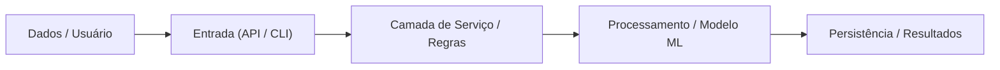

# Architecture Onboarding (Onboarding Arquitetural de Repositórios)

## Visão Geral
Entrar em um repositório novo ou legado é um dos maiores desafios de qualquer equipe de engenharia. Esta skill analisa o repositório como um arqueólogo de código: mapeia os pontos de entrada, o fluxo de dados de ponta a ponta, as decisões de design e gera um roteiro visual interativo (com diagramas Mermaid) que coloca um novo desenvolvedor em produtividade no primeiro dia.

---

## Quando Utilizar
- Ao abrir um projeto novo ou clonar um repositório desconhecido.
- Para gerar documentação arquitetural viva que nunca fica desatualizada.
- Antes de iniciar uma grande refatoração ou migração de sistema.

---

## Estrutura do Guia de Onboarding Gerado

Toda análise produz um arquivo Markdown estruturado em 5 blocos:

### 1. Mapa de Visão Geral (The 30-Second Summary)
- Qual problema de negócio o repositório resolve.
- Stack principal (Linguagens, Frameworks, Banco de Dados, Infraestrutura).
- Ponto de entrada principal da aplicação (ex.: `main.py`, `app.py`, `server.ts`).

### 2. Diagrama de Fluxo de Dados (Mermaid)
Um diagrama visual de fluxo mostrando a jornada de uma requisição/dado:

### 3. Jornada dos Módulos Principais
Tabela clara apontando onde mora cada responsabilidade:

| Pasta / Módulo | O que faz | Arquivo Principal |
|---|---|---|
| `dados/` | Armazena dados de entrada brutos e imutáveis | `fornecedores.csv` |
| `resultados/` | Saídas, relatórios e entregáveis gerados | `*.png`, `*.md` |
| `.agents/skills/`| Habilidades operacionais do assistente | `SKILL.md` |

### 4. As Pegadinhas e Regras Ocultas (Gotchas)
- Quais regras de negócio não estão óbvias no código?
- Há restrições de ambiente ou dados sensíveis?
- O que um desenvolvedor iniciante **nunca deve fazer** neste projeto?

### 5. Roteiro Prático: "Primeiro Commit Seguro"
Instruções passo a passo de como rodar um teste, alterar uma linha de forma segura e validar o resultado localmente.

